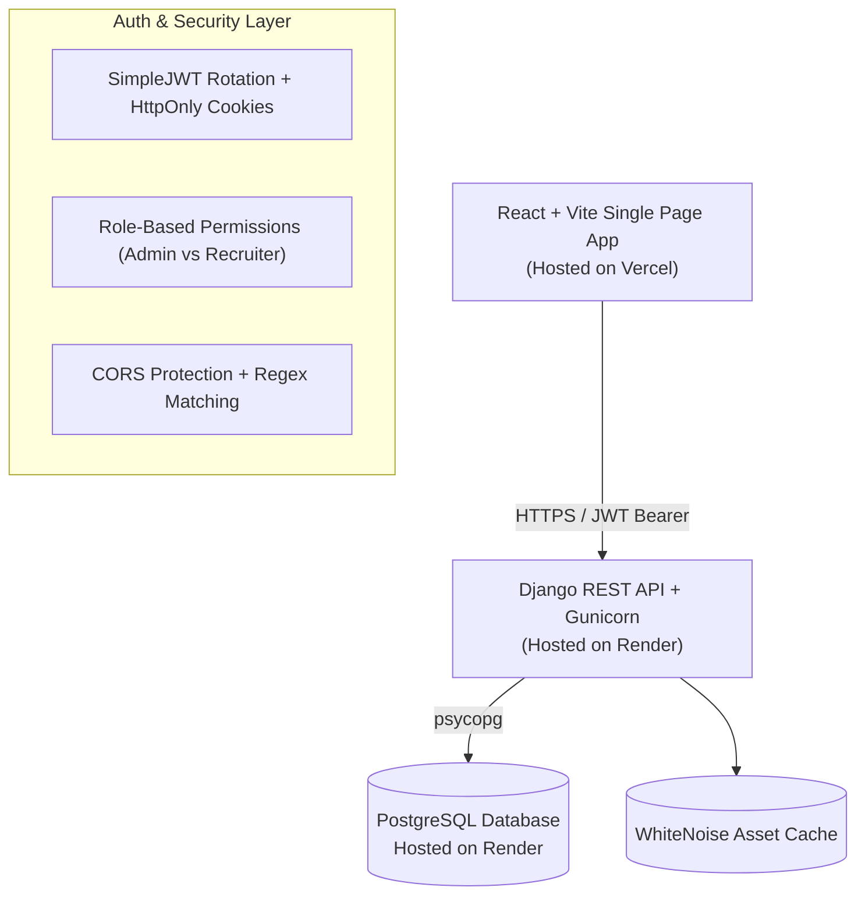

# 🚀 EarlyJobs.ai — Enterprise Applicant Tracking System (ATS)

[](https://ats-tracker-alpha.vercel.app)
[](https://www.djangoproject.com/)
[](https://react.dev/)
[](https://tailwindcss.com/)
[](https://www.postgresql.org/)
[](file:///backend/candidates/tests.py)

A modern, high-performance Applicant Tracking System (ATS) engineered to streamline hiring pipelines with role-based dashboards, isolated recruiter workspaces, real-time funnel analytics, and interactive Kanban stage management.

---

## 🌐 Live Application

- **Production App**: [https://ats-tracker-alpha.vercel.app](https://ats-tracker-alpha.vercel.app)

### 🎬 Video Walkthrough
- **Demo Video**: [Watch Demo Video Walkthrough](https://loom.com) *(Add your Loom or YouTube link here)*

---

## ✨ Key Features

### 1. 🎯 Separate Recruiter Workspaces (Candidate Isolation)
- **Zero Cross-Contamination**: Each recruiter gets their own dedicated dashboard upon login.
- **Strict Data Ownership**: Metrics, recent candidates, candidate rosters, and pipeline stages are strictly scoped to the applicants added by that recruiter.
- **Tamper-Proof REST Security**: Automatic `404 Not Found` enforcement if a recruiter attempts to inspect, modify, or delete candidates outside their scope.

### 2. 🛡️ Administrator Governance & Analytics
- **Enterprise Team Management**: Oversee all company accounts with one-click user approvals, role promotions (Recruiter ↔ Admin), and deactivations.
- **Platform Analytics**: Aggregate candidate volume, role demand, and hiring health across the entire organization.

### 3. 📊 Visual Pipeline Funnel & Analytics
- **Live Funnel Metrics**: Real-time conversion tracking across `Applied`, `Screening`, `Interview`, `Offer`, `Hired`, and `Rejected`.
- **Interactive Stage Breakdown**: Interactive Recharts visualization mapping candidate distribution across stages.

### 4. 🗂️ Kanban Hiring Pipeline
- **Stage Progression Flow**: Advance candidates with single-click next-stage routing or quick-move dropdowns.
- **Quick Applicant Inspection**: Modal view containing contact info, portfolio/resume links, skill tags, and recruiter evaluation notes.

### 5. 🔍 Advanced Candidate Search & Filtering
- **Debounced Instant Search**: Search by candidate name, target role, email, or tagged technical skills with zero typing thrash.
- **Multi-parameter Ordering**: Filter by hiring stage, sort by newest/oldest, candidate name, or years of professional experience.

---

## 🏗️ System Architecture



---

## 🛠️ Technology Stack

### Frontend
- **Framework**: [React 18](https://react.dev/) + [Vite](https://vitejs.dev/)
- **Styling**: [Tailwind CSS](https://tailwindcss.com/)
- **State & Routing**: React Context API, [React Router DOM v6](https://reactrouter.com/)
- **UI Components & Icons**: [Lucide React](https://lucide.dev/), [Framer Motion](https://www.framer.com/motion/)
- **Data Visualization**: [Recharts](https://recharts.org/)
- **HTTP Client**: [Axios](https://axios-http.com/) (with interceptors for token auto-refresh)

### Backend
- **Framework**: [Django 5.2](https://www.djangoproject.com/) + [Django REST Framework (DRF)](https://www.django-rest-framework.org/)
- **Authentication**: `djangorestframework-simplejwt` (Access & Refresh tokens with rotation)
- **Database Engine**: [PostgreSQL](https://www.postgresql.org/) (Production via `psycopg[binary]`), SQLite (Local development)
- **Static Assets**: [WhiteNoise](https://whitenoise.readthedocs.io/) (gzip & manifest caching)
- **WSGI Server**: [Gunicorn](https://gunicorn.org/)
- **Filtering**: `django-filter` + `django-cors-headers`

---

## 📡 API Reference Overview

All private endpoints require Bearer JWT authentication: `Authorization: Bearer <access_token>`.

| Method | Endpoint | Description | Access |
| :--- | :--- | :--- | :--- |
| `GET` | `/api/health/` | Health check & database connection probe | Public |
| `POST` | `/api/auth/login/` | Authenticate user & issue JWT tokens | Public |
| `POST` | `/api/auth/register/` | Register authorized company account | Public |
| `POST` | `/api/auth/refresh/` | Rotate & refresh expired access token | Public |
| `GET` | `/api/auth/me/` | Fetch authenticated user profile & permissions | Verified User |
| `GET` | `/api/dashboard/` | Recruiter-scoped pipeline metrics & distribution | Recruiter / Admin |
| `GET` | `/api/candidates/` | Paginated candidate roster (scoped to creator) | Recruiter / Admin |
| `POST` | `/api/candidates/` | Add new candidate (auto-assigns `created_by`) | Recruiter / Admin |
| `GET` | `/api/candidates/{id}/` | Retrieve candidate details | Candidate Creator / Admin |
| `PATCH` | `/api/candidates/{id}/` | Update candidate stage or background | Candidate Creator / Admin |
| `DELETE` | `/api/candidates/{id}/` | Delete candidate from pipeline | Candidate Creator / Admin |
| `GET` | `/api/admin/stats/` | Platform overview statistics & team counts | Admin Only |
| `GET` | `/api/admin/users/` | Paginated team member management list | Admin Only |
| `POST` | `/api/admin/users/{id}/approve/` | Approve pending company account | Admin Only |
| `POST` | `/api/admin/users/{id}/reject/` | Reject account registration | Admin Only |

---

## 💻 Local Development Setup

### Prerequisites
- Python 3.10+
- Node.js 18+ & npm
- Git

### 1. Clone Repository
```bash
git clone https://github.com/Hemsai123/ats_tracker.git
cd ats_tracker
```

### 2. Backend Setup (Django)
```bash
cd backend

# Create and activate virtual environment
python -m venv .venv
source .venv/bin/activate  # On Windows: .venv\Scripts\activate

# Install Python dependencies
pip install -r requirements.txt

# Run migrations and setup local DB
python manage.py migrate

# (Optional) Seed initial administrator
python manage.py create_initial_admin --email=admin@earlyjobs.in --password=Admin1234!

# Start Django development server
python manage.py runserver
```
*Backend runs at `http://localhost:8000`.*

### 3. Frontend Setup (React + Vite)
```bash
cd ../frontend

# Install node packages
npm install

# Start Vite dev server
npm run dev
```
*Frontend runs at `http://localhost:5173`.*

---

## 🧪 Automated Test Suite

The backend includes a comprehensive test suite covering authentication, permissions, candidate CRUD, filter logic, and multi-recruiter candidate isolation:

```bash
cd backend
python manage.py test candidates accounts -v 2
```

**Results:**
```text
Ran 74 tests in 2.36s
OK (All unit, permission, and isolation tests passing)
```

---

## 🚀 Production Deployment Reference

### Backend (Render)
- **Runtime**: `Python 3`
- **Root Directory**: `backend`
- **Build Command**: `./build.sh`
- **Start Command**: `gunicorn config.wsgi:application`
- **Auto-Configured Environment Variables**:
  - `DATABASE_URL`: Render PostgreSQL connection string
  - `CORS_ALLOWED_ORIGINS`: `https://ats-tracker-alpha.vercel.app`
  - `ALLOWED_HOSTS`: `.onrender.com`

### Frontend (Vercel)
- **Framework Preset**: `Vite`
- **Root Directory**: `frontend`
- **Build Command**: `npm run build`
- **Output Directory**: `dist`
- **Environment Variables**:
  - `VITE_API_BASE_URL`: `https://<your-backend-api-url>/api`

---

## 📄 License & Attribution

Distributed under the MIT License. Built for **EarlyJobs.ai** by the EarlyJobs engineering team.
